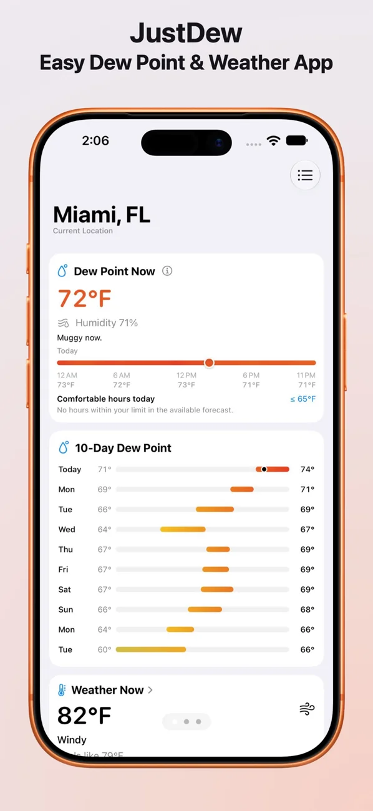
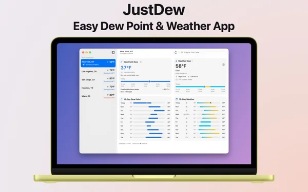
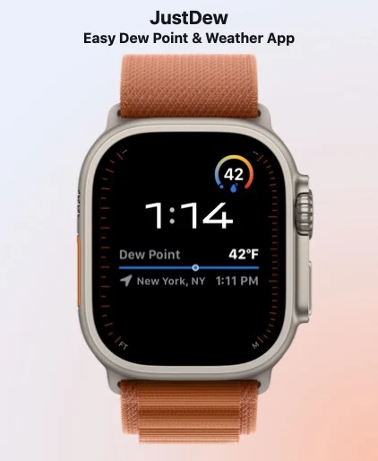

<div align="center">


## JustDew

A focused dew point and weather app for iPhone, iPad, Mac, and Apple Watch.

**[Download JustDew on the App Store](https://apps.apple.com/us/app/justdew-dew-point-widget/id6772215821)**

Free. No subscriptions.

[Website](https://gbabichev.github.io/JustDew/) ·
[Changelog](#changelog) ·
[Support](https://gbabichev.github.io/JustDew/Support.html) ·
[Privacy](https://gbabichev.github.io/JustDew/PrivacyPolicy.html)

</div>

<p align="center">
  <a href="docs/images/iphone-app.webp"></a>
  <a href="docs/images/mac-dashboard.webp"></a>
  <a href="docs/images/watch-4.webp"></a>
</p>

<p align="center">
  <strong>Product website:</strong>
  <a href="https://gbabichev.github.io/JustDew/">gbabichev.github.io/JustDew</a>
</p>

JustDew is a small weather utility built around one useful number: dew point. It uses WeatherKit to show dew point, current weather, and forecasts for your current location or saved cities, then keeps those readings visible through widgets and Apple Watch complications. Free, with no subscriptions.

## Features

- Dew point, temperature, conditions, feels-like, daily highs and lows, rain chance, and humidity
- Up to 10 days of dew point and weather forecasts, including today and nine upcoming days
- Plain-language comfort summaries and comfortable hours today, with a selectable dew point limit
- Hourly rain chance, wind, gusts, and UV details on iPhone, iPad, and Mac
- Saved locations with swipeable pages on iPhone and iPad
- Add, select, and remove cities through the Locations list
- Dew point, weather, and combo widgets for iPhone and Mac, including Always Dark and saved-location options
- iPhone Lock Screen widgets for dew point, weather, or both together
- Apple Watch current readings, compact forecast bars, and dew point or weather complications
- Adaptive iPad and iPhone Duo layouts, with synchronized scrolling across partially folded displays
- Blue to yellow to red dew point comfort scale, with a color legend and explanation on tap
- Celsius or Fahrenheit automatically follows your system preference
- Free, with no subscriptions
- No analytics, ads, tracking, or developer-side location logging

## Requirements

- iOS 26.0 or later
- macOS 26.0 or later
- watchOS 26.0 or later
- Apple WeatherKit availability

## Build From Source

For developers who want to build or contribute to JustDew:

```bash
git clone https://github.com/gbabichev/JustDew.git
cd JustDew
open JustDew.xcodeproj
```

## Locations and Widgets

Open **Locations** and type a city or ZIP code to see Apple Maps autocomplete
suggestions. Select a suggestion to resolve and save that exact place, or use
Current Location.
On iPhone and iPad, swipe between saved location pages. On Mac and Apple Watch,
choose a location from the Locations list. Swipe to delete a saved location on
mobile devices, or use its context menu on Mac.

**Dew Point** and **Dew Point · Always Dark** always follow your current location.
Browsing a saved city in the app does not change them.
Dew point, weather, and combo widgets offer small, medium, and large sizes on iOS
and Mac. Large widgets include forecasts for the coming days.

Use **Dew Point · Location** or **Dew Point · Location · Always Dark** to pin a
widget to a city saved on that device. Both offer small, medium, and large sizes; the
Location widget also supports Lock Screen sizes and an Always Dark switch.
Edit a location widget to choose its location. Each widget keeps its own choice.
System tinting and Lock Screen rendering still control widget presentation.

On Apple Watch, **Current Location** always follows your device.
Add **Saved Location** to your watch face or Smart Stack,
then configure its Location to choose a city saved in the Watch app. Each
complication keeps its own selection when you browse other locations in the app.
Locations are saved separately on each device.

## Changelog

### 2.0.1
- Improved app start on slow internet connection.
- Improved weather forecast showing ? if checking early in the morning.
- Lock Screen widgets show low / high forecats for dew point / weather / combo.

### 2.0.0

- A fresh design keeps dew point first while making room for current weather and both 10-day forecasts.
- See how the air feels in plain language and find comfortable hours for the rest of today using your preferred dew point limit.
- Tap Weather Now on iPhone, iPad, or Mac for hourly rain chance, wind, gusts, and UV. Tap the dew point reading or info button to understand the colors.
- New weather and combo widgets join the dew point widgets, with saved-location, Always Dark, and iPhone Lock Screen options.
- Layouts adapt to iPad and iPhone Duo, including portrait, landscape, and partially folded displays with synchronized scrolling.
- The Watch app now shows current weather and compact, unified bars for both forecasts, alongside dew point and weather complications.
- Temperatures follow your system’s Celsius or Fahrenheit preference.
- All saved locations refresh on launch, and Current Location stays first in the list.
- Current-location widgets follow your device independently of the city open in the app. Use a Location widget or saved-location complication to pin a city.

### 1.0.0

- Initial Release

## Support

Support is handled through [GitHub Issues](https://github.com/gbabichev/JustDew/issues).

## Privacy

See the [Privacy Policy](https://gbabichev.github.io/JustDew/PrivacyPolicy.html).
