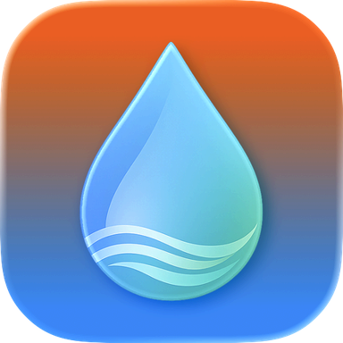
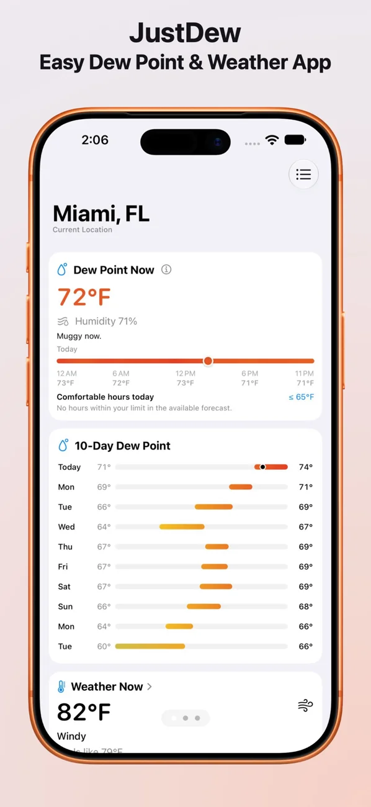
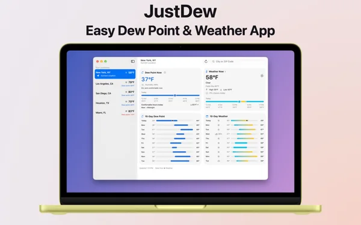
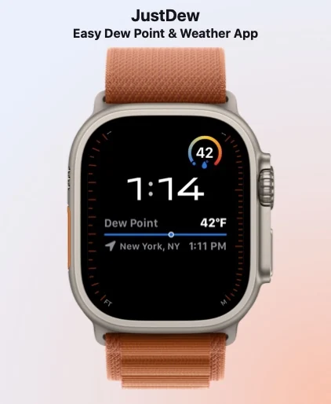

<div align="center">



## JustDew

A focused dew point and weather app for iPhone, iPad, Mac, and Apple Watch.

**[Download JustDew on the App Store](https://apps.apple.com/us/app/justdew-dew-point-widget/id6772215821)**

Free. No subscriptions.

[Website](https://gbabichev.github.io/JustDew/) ·
[Changelog](#changelog) ·
[Support](https://gbabichev.github.io/JustDew/Support.html) ·
[Privacy](https://gbabichev.github.io/JustDew/PrivacyPolicy.html)

</div>

<p align="center">
  <a href="docs/images/iphone-app.webp"></a>
  <a href="docs/images/mac-dashboard.webp"></a>
  <a href="docs/images/watch-4.webp"></a>
</p>

<p align="center">
  <strong>Product website:</strong>
  <a href="https://gbabichev.github.io/JustDew/">gbabichev.github.io/JustDew</a>
</p>

JustDew is a small weather utility built around one useful number: dew point. It uses WeatherKit to show dew point, current weather, and forecasts for your current location or saved cities, then keeps those readings visible through widgets and Apple Watch complications. Free, with no subscriptions.

## Features

- Dew point, temperature, conditions, feels-like, daily highs and lows, rain chance, and humidity
- Up to 10 days of dew point and weather forecasts, including today and nine upcoming days
- Plain-language summaries that explain how the air feels
- Follows your device or per-app language: English, Spanish, Russian, Simplified Chinese, French, German, and Portuguese
- Hourly rain chance, wind, gusts, and UV details on iPhone, iPad, and Mac
- Saved locations with swipeable pages on iPhone and iPad
- Add, select, and remove cities through the Locations list
- Dew point, weather, and combo widgets for iPhone and Mac, including Always Dark and saved-location options
- iPhone Lock Screen widgets for dew point, weather, or both together
- Apple Watch current readings, compact forecast bars, and dew point or weather complications
- Adaptive iPad and iPhone Duo layouts, with synchronized scrolling across partially folded displays
- Blue to yellow to red dew point comfort scale, with a color legend and explanation on tap
- Celsius or Fahrenheit automatically follows your system preference
- Free, with no subscriptions
- No analytics, ads, tracking, or developer-side location logging

## Requirements

- iOS 26.0 or later
- macOS 26.0 or later
- watchOS 26.0 or later
- Apple WeatherKit availability

## Build From Source

For developers who want to build or contribute to JustDew:

```bash
git clone https://github.com/gbabichev/JustDew.git
cd JustDew
open JustDew.xcodeproj
```

### Checking widget layouts

Open `JustDewWidget/WidgetLayoutPreviews.swift` in Xcode and enable the Canvas.
It includes native previews for all three widget types and every supported Home
Screen family. Choose an iPhone, iPad mini, or larger iPad preview destination
and switch timeline entries to check long names, negative readings, and dark mode.
No manual widget installation is needed for these previews.

For a faster side-by-side visual check on a Mac running macOS 27 or later:

```sh
zsh tools/render-widget-gallery.zsh
open /tmp/JustDew-widget-gallery/index.html
```

This renders 99 images from the actual widget views: three widget types across
11 compact/standard/roomy size proposals and three data/appearance scenarios.
The blue border marks the widget bounds, with overflow deliberately left visible.
These are visual stress checks with simulated margins, not exact device snapshots;
use native WidgetKit previews to confirm device-specific scaling and margins.
They also cannot verify Home Screen registration or resizing behavior.

### Dashboard layout policy

Dashboard layout decisions live in `SharedApp/WeatherLayoutPolicy.swift`: navigation
breakpoints, column limits, presentation styles, and forecast density. Hinge geometry
and linked scrolling stay in the folded host. WidgetKit and watchOS retain their own
layouts. Check the policy independently with:

```sh
xcrun swiftc -module-cache-path /tmp/justdew-layout-module-cache \
  SharedApp/WeatherLayoutPolicy.swift Tests/WeatherLayoutPolicyTests.swift \
  -o /tmp/justdew-layout-tests
/tmp/justdew-layout-tests
```


## Locations and Widgets

Open **Locations** and type a city or ZIP code to see Apple Maps autocomplete
suggestions. Select a suggestion to resolve and save that exact place, or use
Current Location.
On iPhone and iPad, swipe between saved location pages. On Mac and Apple Watch,
choose a location from the Locations list. Swipe to delete a saved location on
mobile devices, or use its context menu on Mac.

Choose **Dew Point**, **Weather**, or **Dew Point + Weather**. Each offers small,
medium, and large sizes on iOS and Mac, plus supported iPhone Lock Screen sizes.
Large widgets include forecasts for the coming days.
The wide extra-large size is also available on iPad and Mac.
On iOS/iPadOS 27 and macOS 27, the extra-large portrait size keeps the simple
current-reading header and adds up to ten days of forecasts, including today.
Use the refresh button on Home Screen or Mac widgets to request fresh weather for
that widget's location without opening the app. If offline, the last successful
reading remains visible. Refresh stays at the bottom right of every Home Screen
and Mac widget. The Small combo widget continues to omit the timestamp.

Touch and hold a widget and choose **Edit Widget** (or right-click on Mac) to set
its **Location** to Current Location or a city saved in JustDew, and toggle
**Always Dark**. New widgets default to Current Location and follow the system
appearance. Each widget keeps its own settings when you browse cities in the app.
System tinting and Lock Screen rendering still control widget presentation.

The former Location widgets retain their settings. If you used a retired
Current Location or Always Dark variant, replace it with one of the three widgets
and choose the matching settings in Edit Widget.

On Apple Watch, **Current Location** always follows your device.
Add **Saved Location** to your watch face or Smart Stack,
then configure its Location to choose a city saved in the Watch app. Each
complication keeps its own selection when you browse other locations in the app.
Locations are saved separately on each device.

## Changelog

### 2.1.0
• A simpler widget gallery: choose Dew Point, Weather, or both, then customize your location and appearance.
• Refresh weather directly from your Home Screen or desktop widget.
• New Extra Large widgets for iPad, with more room for forecasts.
• Refined widget layouts, with daily highs and lows and clearer weather icons.
• Cleaner Lock Screen widgets focused on conditions at your current location.
• More compact app layouts, with side-by-side forecasts in landscape on iPhone and iPad.
• Easier-to-read hourly forecasts with color-coded temperatures and UV levels.
• See dew point and current temperature when choosing a location.
• A simpler dew point card with a short summary of how the air feels.
• Improved 10-day forecast availability and fixed the iPad sidebar reopening when rotating.
• Added "Feels Like" temperature to widgets.
• Added Current Location pinning, so you can easily pin your location without having to add it via search.
• Improved dew point lookups in timezones with non 00:00 offsets.

### 2.0.1
- Improved app start on slow internet connection.
- Improved weather forecast showing ? if checking early in the morning.
- Lock Screen widgets show low / high forecats for dew point / weather / combo.

### 2.0.0

- A fresh design keeps dew point first while making room for current weather and both 10-day forecasts.
- See how the air feels in plain language and find comfortable hours for the rest of today using your preferred dew point limit.
- Tap Weather Now on iPhone, iPad, or Mac for hourly rain chance, wind, gusts, and UV. Tap the dew point reading or info button to understand the colors.
- New weather and combo widgets join the dew point widgets, with saved-location, Always Dark, and iPhone Lock Screen options.
- Layouts adapt to iPad and iPhone Duo, including portrait, landscape, and partially folded displays with synchronized scrolling.
- The Watch app now shows current weather and compact, unified bars for both forecasts, alongside dew point and weather complications.
- Temperatures follow your system’s Celsius or Fahrenheit preference.
- All saved locations refresh on launch, and Current Location stays first in the list.
- Current-location widgets follow your device independently of the city open in the app. Use a Location widget or saved-location complication to pin a city.

### 1.0.0

- Initial Release

## Support

Support is handled through [GitHub Issues](https://github.com/gbabichev/JustDew/issues).

## Privacy

See the [Privacy Policy](https://gbabichev.github.io/JustDew/PrivacyPolicy.html).
