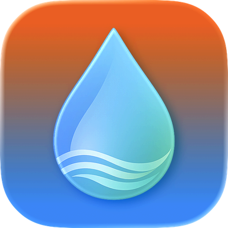
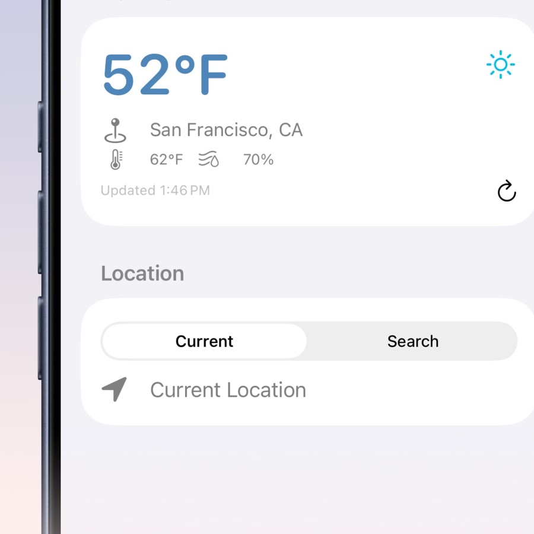
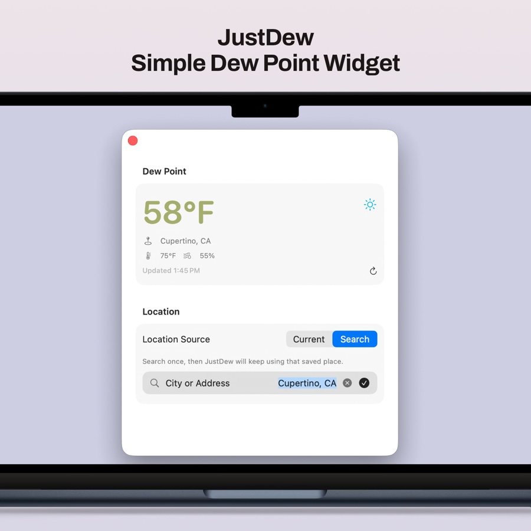
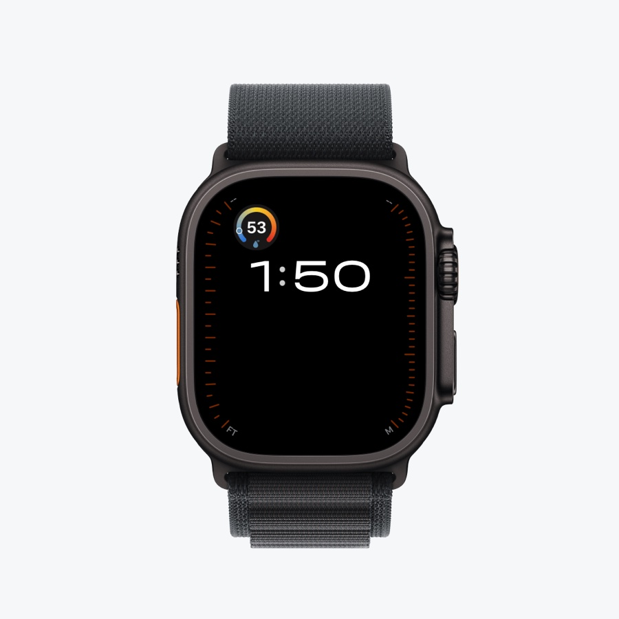

<div align="center">



## JustDew

A focused dew point weather app for iPhone, Mac, and Apple Watch.

[Website](https://gbabichev.github.io/JustDew/) ·
[Changelog](CHANGELOG.md) ·
[Support](https://gbabichev.github.io/JustDew/Support.html) ·
[Privacy](https://gbabichev.github.io/JustDew/PrivacyPolicy.html)

</div>

<p align="center">
  <a href="docs/ios-1.jpg"></a>
  <a href="docs/mac-1.jpg"></a>
  <a href="docs/watch-2.png"></a>
</p>

<p align="center">
  <strong>Product website:</strong>
  <a href="https://gbabichev.github.io/JustDew/">gbabichev.github.io/JustDew</a>
</p>

JustDew is a small weather utility built around one useful number: dew point. It uses WeatherKit to show the current dew point for your current location or a saved city, then keeps that value visible through widgets and Apple Watch complications.

## Features

- Dew point, air temperature, humidity, location, and last update time
- Saved locations with swipeable pages on iPhone and iPad
- Add, select, and remove cities through the Locations list
- iPhone and Mac widgets, including Always Dark and configurable location widgets
- Apple Watch app and complications
- Blue to yellow to red dew point comfort scale
- No analytics, ads, tracking, or developer-side location logging

## Requirements

- iOS 26.0 or later
- macOS 26.0 or later
- watchOS 26.0 or later
- Apple WeatherKit availability

## Build From Source

```bash
git clone https://github.com/gbabichev/JustDew.git
cd JustDew
open JustDew.xcodeproj
```

## Locations and Widgets

Open **Locations** in the app to add a city or ZIP code, or use Current Location.
On iPhone and iPad, swipe between saved location pages. On Mac and Apple Watch,
choose a location from the Locations list. Swipe to delete a saved location on
mobile devices, or use its context menu on Mac.

The widget gallery includes **Dew Point · Location**, **Dew Point · Always Dark**,
and **Dew Point · Location · Always Dark**. The dedicated Location · Always Dark
widget is available in small and medium sizes.
Edit any of these widgets to choose Current Location or a city saved in the app on that
device. The Location widget also offers an Always Dark switch. Each widget keeps
its own location selection when you browse other cities in the app. Existing
Dew Point widgets retain their original behavior of following the app selection.
System tinting and Lock Screen rendering still control widget presentation.

On Apple Watch, add **Dew Point · Location** to your watch face or Smart Stack,
then configure its Location to choose a city saved in the Watch app. Each
complication keeps its own selection when you browse other locations in the app.
Locations are saved separately on each device.

## Storage Checks

Run the focused persistence checks without WeatherKit credentials:

```bash
swiftc -module-cache-path /tmp/JustDewSwiftModuleCache \
  SharedCore/DewPointModels.swift SharedCore/DewPointConfiguration.swift \
  SharedCore/DewPointStore.swift Tests/DewPointStoreTests.swift \
  -o /tmp/JustDewStoreTests
/tmp/JustDewStoreTests
```

## Changelog

### 1.0.0

- Initial Release

## Support

Support is handled through [GitHub Issues](https://github.com/gbabichev/JustDew/issues).

## Privacy

See the [Privacy Policy](https://gbabichev.github.io/JustDew/PrivacyPolicy.html).
